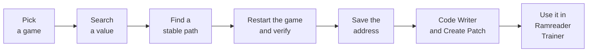

<div align="center">

# Ramreader

**A toolkit that finds stable game memory addresses and turns them into trainers, with as few game restarts as possible.**

**Language:** [Bahasa Indonesia](README.md) | English

[](https://dotnet.microsoft.com/)
[](#getting-started)
[](https://github.com/lepoco/wpfui)
[](#safety-and-limits)
[](#status)
[](LICENSE)

</div>

---

## Why Ramreader

Building a single-player game trainer always stalls on one thing: a **stable memory address**. Addresses change every time the game runs (ASLR, dynamic allocation) and often break after a game update. The usual approach means quitting and relaunching the game over and over.

Ramreader guides the whole process in a Windows 11-style app, from finding an address to using it in a trainer, so you don't need to know the technical jargon to finish a workflow.



## Two apps, one Core

| Project | Role |
|---|---|
| **Ramreader** (`Ramreader.App`) | The finder: value search, stable paths, signatures, code writer, character objects, patch maker, per-game storage. |
| **Ramreader Trainer** (`Ramreader.Trainer`) | Uses the results: feature cards, set value, freeze, code patches, hotkeys. One generic trainer for all games. |
| **Ramreader.Core** | Shared library with no UI: memory access, scanners, pointers, signatures, code caves. |

They are two separate applications, not one program. They are linked through JSON files in `%AppData%`: Ramreader saves the results and the Trainer reads them.

## Features

**Ramreader (finder)**

- **Value search** in the style of Cheat Engine: exact, changed, unchanged, increased, decreased. Supports int32, float, int64, and double.
- **Snapshot and value range** for values that are not shown as numbers (for example an HP bar).
- **Stable Path**: multi-level pointer search (BFS) toward the target address, then **verification after a game restart** to keep only paths that really survive.
- **Signature (AOB)**: byte patterns with wildcards, generated automatically from game code, as a fallback when a path breaks after an update.
- **Code Writer**: a hardware-breakpoint debugger that captures the instruction writing to an address ("find out what writes").
- **Character Object**: inspects character objects in memory and the side structure (team and enemy), including a reverse container search.
- **Create Patch**: builds a code cave from the captured instruction.
- **Saved**: per-game addresses read live from the game, stored on disk, and **exported as a JSON profile**.
- **Modern UI**: Fluent, dark, Mica, side navigation, and a status bar that always shows the next step.

**Ramreader Trainer**

- **Set value** with range validation, and **freeze** a value.
- **Preset and auto-freeze**: a value is locked once when the game is detected (for example, a team bar that is always 100).
- **Code patches** through toggles, e.g. HP, chakra, cooldowns. A player-only code cave means **enemies stay normal**.
- **Patch modes** that decide who is protected (see [Patch modes](#patch-modes)).
- Global hotkeys (still being tested).

## Status

This project is in **beta**. "Proven" below means tested by the author on the test game, not a guarantee for every game.

| Part | Status |
|---|---|
| Attach to a process and read memory | Proven |
| Value search (first and next scan), Snapshot | Proven |
| Range scan (between) | Code in place, not tested |
| Stable Path + restart verification | Proven |
| Signature (AOB) | Proven on the test game |
| Saved + Export Profile | Proven |
| Code Writer + Create Patch | Proven |
| Trainer: set value and freeze | Proven |
| Trainer: auto-freeze (Preset + AutoFreeze) | Proven (team bar) |
| Trainer: code patches (HP, chakra, summon cooldown) | Proven |
| Trainer: unlimited Tag Switch and Kawarimi | Reported stable; Tag Switch after a PC restart not tested |
| Tree mode (the whole player side, including mirror matches) | Proven for HP and chakra |
| Global hotkeys, per-feature min/max limits | Code in place, not tested |
| Games other than the test game (NSUNSC) | Not tested |

Test game: **NSUNSC** (Naruto x Boruto: Ultimate Ninja Storm Connections), offline mode.

<!--
## Screenshots
Put images in docs/screenshots, then remove this comment, e.g.:


-->

## Getting started

**Requirements**

- Windows 11, 64-bit
- [.NET SDK 10.0](https://dotnet.microsoft.com/download)
- Run the terminal or VS Code **as Administrator** (needed to open the game process)

**Build and run**

```powershell
git clone https://github.com/fathun12/Ramreader.git
cd Ramreader
dotnet build
dotnet run --project src\Ramreader.App
dotnet run --project src\Ramreader.Trainer
```

Run Ramreader and the Trainer from separate Administrator terminals, or start both from one Administrator terminal.

## How to use

### 1. Find a stable address (Ramreader)

1. **Process**: pick the running game and connect.
2. **Value search**: scan the value you see in the game. Change it in the game, then Next Scan until few addresses remain. Pick one and click **Set as Target**.
3. **Stable Path**: click **Find Path**, close and reopen the game, search the value again, then **Verify**. Repeat until only a few paths remain.
4. **Save Address** with a label (for example "HP"), then check the **Saved** menu.

Tip: for bars with round values (100, 75, 50), a First Scan with the value you see is more accurate than a Snapshot.

### 2. Create a patch (optional, for features such as God Mode)

1. Open **Code Writer**, pick a saved address, then **Start Monitoring**.
2. Perform the action in the game (take damage, use a skill) until the writer instruction appears.
3. Pick the full writer instruction row, not an overlapping byte-fragment row, then **Create Patch**.
4. Click **Stop** before closing Ramreader.

### 3. Use it in the Trainer

1. Start the game, then Ramreader Trainer. The Trainer loads the game profile from the saved session.
2. Activate the feature cards: set value, freeze, or patch toggles.
3. **Turn patch toggles off before closing the Trainer.**

## Patch modes

The mode decides who a patch protects. Set it with the `Mode` field of the patch in the session file (see [Data locations](#data-locations)).

| Mode | Behavior |
|---|---|
| empty (default) | The player's main character only. Enemies stay normal. |
| `Team` | The whole player team, using a 12-byte marker in the character object. Does not support mirror matches (both sides share the same main character). |
| `Tree` | The whole player side by walking the side tree structure. Supports mirror matches. Built from the test game's object structure. |
| `Nop` | Plain NOP. **Not recommended**: enemies become invulnerable too because the instruction is shared. |

Changing `Mode` is done by text replacement in the JSON. **Do not** read and rewrite the JSON with `ConvertFrom-Json` and `ConvertTo-Json` in PowerShell 5.1: dates get corrupted and the profile disappears from the Trainer. Make a backup (`.bak`) first, replace the text only, and check that the replacement count matches.

## Data locations

| Data | Location |
|---|---|
| Sessions and saved addresses | `%AppData%\Ramreader\sessions\<game>.json` |
| Candidate paths | `%AppData%\Ramreader\chains\<game>.txt` |
| Per-feature Trainer settings | `%AppData%\Ramreader.Trainer\settings\<game>.json` |

## Game profile format

The export is a JSON file read by the trainer (example):

```json
{
  "FormatVersion": 1,
  "GameName": "NSUNSC",
  "ExportedAt": "2026-11-01T15:17:20+07:00",
  "Addresses": [
    {
      "Label": "HP",
      "ValueType": "Float",
      "VerifiedRounds": 1,
      "MainModuleSize": 166223872,
      "Chains": [
        "NSUNSC.exe|21D74B8|250,0,38"
      ],
      "Signatures": []
    }
  ]
}
```

Path format: `Module|ModuleOffset|offset1,offset2,...` (hex). The address is computed by reading the pointer at `Module+ModuleOffset`, adding the first offset, then repeating for the next offsets. `MainModuleSize` helps the trainer detect that the game has been updated.

## Using it on other games

The workflow is general, but it has only been tested on one game. What you should know:

- Address search (Value search, Stable Path, Signature) does not depend on a specific game.
- `Tree` mode was built from the test game's object structure. Other games almost certainly have a different structure, so the side marker has to be found again with **Character Object**. For ordinary single-player games, the empty mode may be enough.
- Games with Denuvo or anti-cheat may refuse access to their process. Check the game's protection first.

## Architecture

```
src/
  Ramreader.Core/            pure logic, no UI dependency
    Memory/                  ProcessMemory, ProcessLister, P/Invoke
    Scanning/                ValueScanner, AobPattern, AobScanner,
                             RipReferenceScanner, SignatureMaker, SignatureResolver
    Pointers/                PointerScanner, PointerVerifier, PointerChain, AddressResolver
    Debugging/               CodeCave, SideTree, ReversePointerFinder
    Models/                  SavedAddress, SignatureRef, GameProfile, ...
  Ramreader.App/             WPF + MVVM (finder)
    Views/ ViewModels/       pages and view logic
    Services/                GameSession, SavedStore, ChainStore
    Themes/AppStyles.xaml    all styling in one place
  Ramreader.Trainer/         WPF (generic trainer)
    Services/                TrainerSession, ProfileStore, MemoryWriter,
                             SettingsStore, HotkeyService
    ViewModels/              MainViewModel, FeatureItem, PatchItem
```

Stack: **C# / .NET 10**, **WPF**, [WPF-UI](https://github.com/lepoco/wpfui) 4.3.0, [CommunityToolkit.Mvvm](https://github.com/CommunityToolkit/dotnet) 8.4.2, `Microsoft.Extensions.DependencyInjection`.

Algorithm design, proof history, and dead ends are documented in [`SPEC.md`](SPEC.md) (in Indonesian).

## Safety and limits

- **Searching is read-only.** Value search, Stable Path, and Signature only read game memory.
- **Code Writer uses a debugger** (hardware breakpoint) on the game. **The Trainer writes to game memory** and installs code caves for patches.
- **Single-player / offline games only.** Do not use it in online or competitive games.
- **It does not bypass anti-cheat.** Games protected by Denuvo or kernel anti-cheat may refuse access or detect this activity. That is outside the scope of this project.
- **Force-closing is risky.** Force-closing the Trainer while a patch is on can leave a jump to an old code cave in the game: turn toggles off first. Click **Stop** in Ramreader before closing it (suspected, not proven: force-closing while monitoring leaves a breakpoint behind and can crash the game).
- You are responsible for how you use it and for complying with the terms of service of the game you use it on.

## Roadmap

- [x] RAM reader, Value search, Stable Path, Saved, Export Profile
- [x] Snapshot (unknown initial value)
- [x] Signature (AOB)
- [x] Simple debugger (hardware breakpoint) for "find out what writes"
- [x] `Ramreader.Trainer`: set value, freeze, code patches, Team and Tree modes
- [ ] Field verification: range scan, global hotkeys
- [ ] Test on games other than the test game
- [ ] Pointer scan for multiple targets at once
- [ ] Option to add other DLLs as static modules
- [ ] 1/2 byte types, array of bytes, hex viewer

## License

Released under the [MIT License](LICENSE).