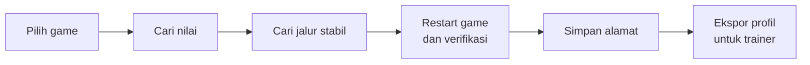

<div align="center">

# Ramreader

**Pembaca RAM untuk menemukan alamat memori game yang stabil, dengan sesedikit mungkin restart.**

[](https://dotnet.microsoft.com/)
[](#memulai)
[](https://github.com/lepoco/wpfui)
[](#keamanan-dan-batasan)
[](#status)
[](LICENSE)

</div>

---

## Mengapa Ramreader

Membuat trainer game single-player selalu tersandung di satu hal: **alamat memori yang stabil**. Alamat berubah tiap game dijalankan (ASLR, alokasi dinamis) dan sering patah setelah game di-update. Cara biasa menuntut keluar-masuk game berkali-kali.

Ramreader memandu seluruh alurnya dalam satu aplikasi bergaya Windows 11, sehingga kamu tidak perlu paham istilah teknis untuk menyelesaikan satu alur.



## Fitur

- **Cari Nilai** bergaya Cheat Engine: nilai tepat, berubah, tidak berubah, bertambah, berkurang. Mendukung int32, float, int64, dan double.
- **Snapshot dan rentang nilai** untuk nilai yang tidak tampil sebagai angka (misalnya bar HP).
- **Jalur Stabil**: pencarian pointer multi-level (BFS) menuju alamat target, lalu **verifikasi setelah restart game** untuk menyaring jalur yang benar-benar bertahan.
- **Signature (AOB)**: pola byte dengan wildcard yang dibuat otomatis dari kode game, sebagai cadangan kalau jalur putus setelah update.
- **Tersimpan**: alamat per game dibaca langsung dari game (live), disimpan di disk, dan **diekspor sebagai profil JSON** untuk trainer.
- **UI modern**: Fluent, dark, Mica, navigasi samping, bilah status yang selalu memberi langkah berikutnya.
- **Core terpisah dari UI** (`Ramreader.Core`) supaya bisa dipakai ulang oleh trainer.

## Status

Proyek ini **beta** dan masih dikembangkan. Status tiap bagian:

| Bagian | Status |
|---|---|
| Menyambung ke proses dan membaca memori | Terbukti jalan |
| Cari Nilai (scan pertama dan lanjutan) | Terbukti jalan |
| Snapshot (nilai awal tidak diketahui) | Terbukti jalan (HP game uji ditemukan) |
| Scan Rentang (between) | Kode terpasang, belum dites |
| Jalur Stabil + verifikasi restart | Terbukti jalan |
| Tersimpan + Ekspor Profil | Terbukti jalan |
| Signature (AOB + RIP-relative) | Kode terpasang, belum dites |
| Trainer (`Ramreader.Trainer`) | Direncanakan |

<!--
## Tangkapan layar
Taruh gambar di folder docs/screenshots lalu hapus tanda komentar ini, mis.:


-->

## Memulai

**Prasyarat**

- Windows 11
- [.NET SDK 10.0](https://dotnet.microsoft.com/download)
- Untuk membaca game yang terproteksi, jalankan terminal atau VS Code **sebagai Administrator**

**Build dan jalankan**

```powershell
git clone https://github.com/fathun12/Ramreader.git
cd Ramreader
dotnet build
dotnet run --project src\Ramreader.App
```

**Alur singkat**

1. **Proses**: pilih game yang sedang berjalan, lalu hubungkan.
2. **Cari Nilai**: scan nilai yang kamu lihat di game. Ubah nilainya di game, lalu Scan Lanjutan sampai tinggal sedikit alamat. Pilih satu dan klik **Jadikan Target**.
3. **Jalur Stabil**: klik **Cari Jalur**, tutup dan buka lagi game, cari nilainya lagi, lalu **Verifikasi**. Ulangi sampai tinggal sedikit jalur.
4. **Simpan Alamat** dengan label (misalnya "HP"), lalu lihat di menu **Tersimpan**.
5. **Ekspor Profil** untuk dipakai trainer.

## Format profil game

Hasil ekspor adalah JSON yang dibaca trainer:

```json
{
  "FormatVersion": 1,
  "GameName": "NSUNSC",
  "ExportedAt": "2026-11-01T15:17:20+07:00",
  "Addresses": [
    {
      "Label": "HP",
      "ValueType": "Float",
      "VerifiedRounds": 1,
      "MainModuleSize": 166223872,
      "Chains": [
        "NSUNSC.exe|21D74B8|250,0,38"
      ],
      "Signatures": []
    }
  ]
}
```

Format jalur: `Modul|OffsetModul|offset1,offset2,...` (hex). Alamat dihitung dengan membaca pointer di `Modul+OffsetModul`, menambah offset pertama, lalu mengulang untuk offset berikutnya. `MainModuleSize` membantu trainer mendeteksi bahwa game sudah di-update.

## Arsitektur

```
src/
  Ramreader.Core/            logika murni, tanpa dependensi UI
    Memory/                  ProcessMemory (read-only), ProcessLister, P/Invoke
    Scanning/                ValueScanner, AobPattern, AobScanner,
                             RipReferenceScanner, SignatureMaker, SignatureResolver
    Pointers/                PointerScanner, PointerVerifier, PointerChain
    Models/                  SavedAddress, SignatureRef, GameProfile, ...
  Ramreader.App/             WPF + MVVM
    Views/ ViewModels/       halaman dan logika tampilan
    Services/                GameSession, SavedStore, ChainStore
    Themes/AppStyles.xaml    semua gaya tampilan di satu tempat
```

Stack: **C# / .NET 10**, **WPF**, [WPF-UI](https://github.com/lepoco/wpfui) 4.3.0, [CommunityToolkit.Mvvm](https://github.com/CommunityToolkit/dotnet) 8.4.2, `Microsoft.Extensions.DependencyInjection`.

Detail desain algoritma dan catatan lapangan ada di [`SPEC.md`](SPEC.md).

## Keamanan dan batasan

- **Read-only.** Handle proses dibuka hanya dengan `VM_READ | QUERY_INFORMATION`. Ramreader tidak pernah menulis ke memori game. Penulisan baru direncanakan di fase 2, di proyek terpisah.
- **Hanya untuk game single-player / offline.** Jangan dipakai di game online atau kompetitif.
- **Tidak membypass anti-cheat.** Game dengan perlindungan seperti Denuvo atau anti-cheat kernel bisa menolak akses atau mendeteksi pembacaan memori. Itu di luar tujuan proyek ini.
- Kamu bertanggung jawab atas penggunaannya dan atas kepatuhan pada syarat layanan game yang kamu pakai.

## Roadmap

- [x] Pembaca RAM, Cari Nilai, Jalur Stabil, Tersimpan, Ekspor Profil
- [x] Snapshot (nilai awal tidak diketahui)
- [ ] Verifikasi lapangan: Scan Rentang dan Signature
- [ ] Pointer scan dengan banyak target sekaligus
- [ ] Opsi menambah DLL lain sebagai modul statis
- [ ] Debugger sederhana (hardware breakpoint) untuk "find out what writes"
- [ ] Tipe 1/2 byte, array of bytes, hex viewer
- [ ] **Fase 2:** `Ramreader.Trainer` (set nilai, freeze, hotkey) berbasis profil game

## Lisensi

Dirilis di bawah [MIT License](LICENSE).