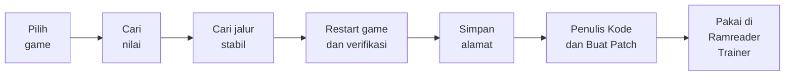

<div align="center">

# Ramreader

**Toolkit untuk menemukan alamat memori game yang stabil, lalu mengubahnya jadi trainer, dengan sesedikit mungkin restart.**

**Bahasa:** Indonesia | [English](README.en.md)

[](https://dotnet.microsoft.com/)
[](#memulai)
[](https://github.com/lepoco/wpfui)
[](#keamanan-dan-batasan)
[](#status)
[](LICENSE)

</div>

---

## Mengapa Ramreader

Membuat trainer game single-player selalu tersandung di satu hal: **alamat memori yang stabil**. Alamat berubah tiap game dijalankan (ASLR, alokasi dinamis) dan sering patah setelah game di-update. Cara biasa menuntut keluar-masuk game berkali-kali.

Ramreader memandu seluruh alurnya dalam aplikasi bergaya Windows 11, dari mencari alamat sampai memakainya di trainer, sehingga kamu tidak perlu paham istilah teknis untuk menyelesaikan satu alur.



## Dua aplikasi, satu Core

| Proyek | Peran |
|---|---|
| **Ramreader** (`Ramreader.App`) | Alat pencari: cari nilai, jalur stabil, signature, penulis kode, objek karakter, pembuat patch, penyimpanan per game. |
| **Ramreader Trainer** (`Ramreader.Trainer`) | Pemakai hasilnya: kartu fitur, set nilai, kunci (freeze), patch kode, hotkey. Satu trainer generik untuk semua game. |
| **Ramreader.Core** | Pustaka bersama tanpa UI: akses memori, scanner, pointer, signature, code cave. |

Keduanya aplikasi terpisah, bukan satu program. Mereka terhubung lewat berkas JSON di `%AppData%`: Ramreader menyimpan hasil, Trainer membacanya.

## Fitur

**Ramreader (pencari)**

- **Cari Nilai** bergaya Cheat Engine: nilai tepat, berubah, tidak berubah, bertambah, berkurang. Mendukung int32, float, int64, dan double.
- **Snapshot dan rentang nilai** untuk nilai yang tidak tampil sebagai angka (misalnya bar HP).
- **Jalur Stabil**: pencarian pointer multi-level (BFS) menuju alamat target, lalu **verifikasi setelah restart game** untuk menyaring jalur yang benar-benar bertahan.
- **Signature (AOB)**: pola byte dengan wildcard yang dibuat otomatis dari kode game, sebagai cadangan kalau jalur putus setelah update.
- **Penulis Kode**: debugger berbasis hardware breakpoint yang menangkap instruksi yang menulis ke sebuah alamat ("find out what writes").
- **Objek Karakter**: memeriksa objek karakter di memori dan struktur sisi (tim dan musuh), termasuk pencarian penampung objek.
- **Buat Patch**: membuat code cave dari instruksi yang tertangkap.
- **Tersimpan**: alamat per game dibaca langsung dari game (live), disimpan di disk, dan **diekspor sebagai profil JSON**.
- **UI modern**: Fluent, dark, Mica, navigasi samping, bilah status yang selalu memberi langkah berikutnya.

**Ramreader Trainer**

- **Set nilai** dengan validasi rentang, dan **Kunci (freeze)** nilai.
- **Preset dan kunci otomatis**: nilai dikunci sekali saat game terdeteksi (contoh: bar tim selalu 100).
- **Patch kode** lewat toggle, mis. HP, chakra, cooldown. Dengan code cave khusus pemain, sehingga **musuh tetap normal**.
- **Mode patch** untuk menentukan siapa yang terlindungi (lihat [Mode patch](#mode-patch)).
- Hotkey global (masih dalam pengujian).

## Status

Proyek ini **beta**. "Terbukti" di bawah berarti sudah diuji pembuat di game uji, bukan jaminan untuk semua game.

| Bagian | Status |
|---|---|
| Menyambung ke proses dan membaca memori | Terbukti |
| Cari Nilai (scan pertama dan lanjutan), Snapshot | Terbukti |
| Scan Rentang (between) | Kode terpasang, belum dites |
| Jalur Stabil + verifikasi restart | Terbukti |
| Signature (AOB) | Terbukti di game uji |
| Tersimpan + Ekspor Profil | Terbukti |
| Penulis Kode + Buat Patch | Terbukti |
| Trainer: set nilai dan kunci | Terbukti |
| Trainer: kunci otomatis (Preset + AutoFreeze) | Terbukti (bar tim) |
| Trainer: patch kode (HP, chakra, cooldown summon) | Terbukti |
| Trainer: Tag Switch dan Kawarimi tanpa batas | Dilaporkan stabil; Tag Switch setelah restart PC belum dites |
| Mode Tree (seluruh sisi pemain, termasuk mirror match) | Terbukti untuk HP dan chakra |
| Hotkey global, batas min/max per fitur | Kode terpasang, belum dites |
| Game selain game uji (NSUNSC) | Belum diuji |

Game uji: **NSUNSC** (Naruto x Boruto: Ultimate Ninja Storm Connections), mode offline.

<!--
## Tangkapan layar
Taruh gambar di folder docs/screenshots lalu hapus tanda komentar ini, mis.:


-->

## Memulai

**Prasyarat**

- Windows 11, 64-bit
- [.NET SDK 10.0](https://dotnet.microsoft.com/download)
- Jalankan terminal atau VS Code **sebagai Administrator** (diperlukan untuk membuka proses game)

**Build dan jalankan**

```powershell
git clone https://github.com/fathun12/Ramreader.git
cd Ramreader
dotnet build
dotnet run --project src\Ramreader.App
dotnet run --project src\Ramreader.Trainer
```

Jalankan Ramreader dan Trainer di terminal Administrator terpisah, atau jalankan keduanya dari satu terminal Administrator.

## Cara memakai

### 1. Cari alamat stabil (Ramreader)

1. **Proses**: pilih game yang sedang berjalan, lalu hubungkan.
2. **Cari Nilai**: scan nilai yang kamu lihat di game. Ubah nilainya di game, lalu Scan Lanjutan sampai tinggal sedikit alamat. Pilih satu dan klik **Jadikan Target**.
3. **Jalur Stabil**: klik **Cari Jalur**, tutup dan buka lagi game, cari nilainya lagi, lalu **Verifikasi**. Ulangi sampai tinggal sedikit jalur.
4. **Simpan Alamat** dengan label (misalnya "HP"), lalu lihat di menu **Tersimpan**.

Tips: untuk bar yang bernilai bulat (100, 75, 50), Scan Pertama dengan nilai yang kamu lihat lebih akurat daripada Snapshot.

### 2. Buat patch (opsional, untuk fitur seperti God Mode)

1. Buka **Penulis Kode**, pilih alamat tersimpan, lalu **Mulai Pantau**.
2. Lakukan aksinya di game (kena damage, pakai skill) sampai instruksi penulis muncul.
3. Pilih baris instruksi penulis yang utuh, bukan baris potongan byte yang tumpang tindih dengannya, lalu **Buat Patch**.
4. Klik **Berhenti** sebelum menutup Ramreader.

### 3. Pakai di Trainer

1. Jalankan game, lalu Ramreader Trainer. Trainer memuat profil game dari sesi tersimpan.
2. Aktifkan kartu fitur: set nilai, kunci, atau toggle patch.
3. **Matikan toggle patch sebelum menutup Trainer.**

## Mode patch

Mode menentukan siapa yang terlindungi oleh sebuah patch. Atur lewat field `Mode` pada patch di berkas sesi (lihat [Lokasi data](#lokasi-data)).

| Mode | Perilaku |
|---|---|
| kosong (bawaan) | Hanya karakter utama pemain. Musuh normal. |
| `Team` | Seluruh tim pemain, memakai penanda 12 byte di objek karakter. Tidak mendukung mirror match (karakter utama kedua sisi sama). |
| `Tree` | Seluruh sisi pemain dengan menelusuri struktur pohon sisi. Mendukung mirror match. Dibuat dari struktur objek game uji. |
| `Nop` | NOP polos. **Tidak disarankan**: musuh ikut kebal karena instruksinya dipakai bersama. |

Mengubah `Mode` dilakukan dengan penggantian teks di JSON. **Jangan** membaca lalu menulis ulang JSON lewat `ConvertFrom-Json` dan `ConvertTo-Json` di PowerShell 5.1: format tanggal rusak dan profil hilang dari Trainer. Buat cadangan (`.bak`) dulu, ganti teksnya saja, lalu pastikan jumlah penggantiannya sesuai.

## Lokasi data

| Data | Lokasi |
|---|---|
| Sesi dan alamat tersimpan | `%AppData%\Ramreader\sessions\<game>.json` |
| Jalur kandidat | `%AppData%\Ramreader\chains\<game>.txt` |
| Pengaturan Trainer per fitur | `%AppData%\Ramreader.Trainer\settings\<game>.json` |

## Format profil game

Hasil ekspor adalah JSON yang dibaca trainer (contoh):

```json
{
  "FormatVersion": 1,
  "GameName": "NSUNSC",
  "ExportedAt": "2026-11-01T15:17:20+07:00",
  "Addresses": [
    {
      "Label": "HP",
      "ValueType": "Float",
      "VerifiedRounds": 1,
      "MainModuleSize": 166223872,
      "Chains": [
        "NSUNSC.exe|21D74B8|250,0,38"
      ],
      "Signatures": []
    }
  ]
}
```

Format jalur: `Modul|OffsetModul|offset1,offset2,...` (hex). Alamat dihitung dengan membaca pointer di `Modul+OffsetModul`, menambah offset pertama, lalu mengulang untuk offset berikutnya. `MainModuleSize` membantu trainer mendeteksi bahwa game sudah di-update.

## Memakai di game lain

Alurnya umum, tetapi baru teruji di satu game. Yang perlu kamu ketahui:

- Pencarian alamat (Cari Nilai, Jalur Stabil, Signature) tidak bergantung pada game tertentu.
- Mode `Tree` dibuat dari struktur objek game uji. Game lain hampir pasti punya struktur berbeda, jadi penanda sisi perlu dicari ulang lewat **Objek Karakter**. Untuk game single-player biasa, Mode kosong mungkin sudah cukup.
- Game dengan Denuvo atau anti-cheat bisa menolak akses ke prosesnya. Periksa proteksi game dulu.

## Arsitektur

```
src/
  Ramreader.Core/            logika murni, tanpa dependensi UI
    Memory/                  ProcessMemory, ProcessLister, P/Invoke
    Scanning/                ValueScanner, AobPattern, AobScanner,
                             RipReferenceScanner, SignatureMaker, SignatureResolver
    Pointers/                PointerScanner, PointerVerifier, PointerChain, AddressResolver
    Debugging/               CodeCave, SideTree, ReversePointerFinder
    Models/                  SavedAddress, SignatureRef, GameProfile, ...
  Ramreader.App/             WPF + MVVM (pencari)
    Views/ ViewModels/       halaman dan logika tampilan
    Services/                GameSession, SavedStore, ChainStore
    Themes/AppStyles.xaml    semua gaya tampilan di satu tempat
  Ramreader.Trainer/         WPF (trainer generik)
    Services/                TrainerSession, ProfileStore, MemoryWriter,
                             SettingsStore, HotkeyService
    ViewModels/              MainViewModel, FeatureItem, PatchItem
```

Stack: **C# / .NET 10**, **WPF**, [WPF-UI](https://github.com/lepoco/wpfui) 4.3.0, [CommunityToolkit.Mvvm](https://github.com/CommunityToolkit/dotnet) 8.4.2, `Microsoft.Extensions.DependencyInjection`.

Detail desain algoritma, riwayat bukti, dan jalan buntu ada di [`SPEC.md`](SPEC.md).

## Keamanan dan batasan

- **Pencarian bersifat baca.** Cari Nilai, Jalur Stabil, dan Signature hanya membaca memori game.
- **Penulis Kode memakai debugger** (hardware breakpoint) pada game. **Trainer menulis ke memori game** dan memasang code cave untuk patch.
- **Hanya untuk game single-player / offline.** Jangan dipakai di game online atau kompetitif.
- **Tidak membypass anti-cheat.** Game dengan perlindungan seperti Denuvo atau anti-cheat kernel bisa menolak akses atau mendeteksi aktivitas ini. Itu di luar tujuan proyek.
- **Penutupan paksa berisiko.** Menutup Trainer paksa saat patch menyala dapat meninggalkan lompatan ke code cave lama di game: matikan toggle dulu. Klik **Berhenti** di Ramreader sebelum menutupnya (dugaan, belum terbukti: menutup paksa saat memantau meninggalkan breakpoint dan bisa membuat game crash).
- Kamu bertanggung jawab atas penggunaannya dan atas kepatuhan pada syarat layanan game yang kamu pakai.

## Roadmap

- [x] Pembaca RAM, Cari Nilai, Jalur Stabil, Tersimpan, Ekspor Profil
- [x] Snapshot (nilai awal tidak diketahui)
- [x] Signature (AOB)
- [x] Debugger sederhana (hardware breakpoint) untuk "find out what writes"
- [x] `Ramreader.Trainer`: set nilai, kunci, patch kode, Mode Team dan Tree
- [ ] Verifikasi lapangan: Scan Rentang, hotkey global
- [ ] Uji di game selain game uji
- [ ] Pointer scan dengan banyak target sekaligus
- [ ] Opsi menambah DLL lain sebagai modul statis
- [ ] Tipe 1/2 byte, array of bytes, hex viewer

## Lisensi

Dirilis di bawah [MIT License](LICENSE).